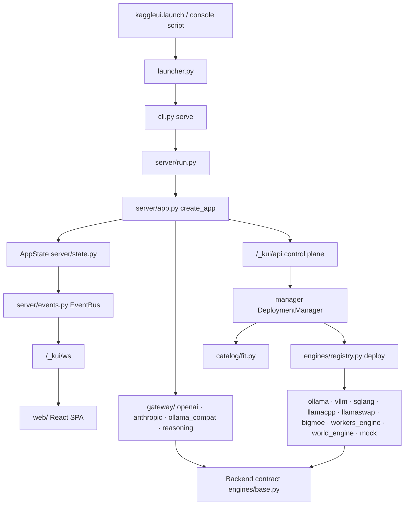

# Repository Guidelines

KaggleUI — a one-cell control panel and multi-protocol inference gateway that hosts AI models (text, image, video, TTS/STT, 3D world) on Kaggle's free GPUs/TPUs. Python backend, React SPA shipped inside the wheel.

## Project Overview

A user pastes one cell into a Kaggle notebook:

```python
!curl -fsSL https://raw.githubusercontent.com/therealfreddied/KaggleUI/main/install.sh | bash
import kaggleui
kaggleui.launch()
```

`launch()` starts the FastAPI server in a background process, prints a link card (Cloudflare/ngrok tunnel URL + admin token, access password, API key), and keeps the cell alive. The panel then lets the user pick a model, deploy it behind an isolated runner, and talk to it through OpenAI, Anthropic, or Ollama-compatible APIs plus the built-in Studio.

Constraints that shape every design decision: Kaggle sessions are ephemeral, 20 GB of `/kaggle/working` is saved as output, and the preinstalled PyTorch stack must not be broken by `pip install`.

## Architecture & Data Flow



**Entry chain**: `kaggleui/__init__.py` (`launch`, `stop`) → `launcher.py` (state file, tunnel, `subprocess.Popen` of the server) → `cli.py` (`serve` subcommand; console scripts are `kaggleui` and `kui`) → `server/run.py` (`build_state()` + `make_server()`) → `server/app.py` `create_app(AppState)` → `server/state.py` `AppState`.

**`AppState`** is the process-wide container, no other globals: `paths`, `settings`, `port`, `mock`, `fake_hw`, `preset`, `secrets`, `video_jobs`, `world_jobs`, and `init=False` subsystems — `auth`, `bus`, `probe`, `catalog`, `imports`, `tunnels`, `manager` (DeploymentManager), `interfaces`, `updates`, `workbench`, `jobs` (JobStore), `residency`, `artifacts` (ArtifactRegistry), `storage`, `optimize`, `host` (HostAdapter), `quota`, `management`. Routes read `request.app.state.kui`; nothing else reaches for globals.

**Backend contract** (`engines/base.py`): `chat`, `chat_stream`, `completions`, `embeddings`, `images`, `speech`, `voices`, `voice_info`, `transcribe`, `job_submit`, `job_status`, `job_result`, `job_assets`, `close`. Unimplemented methods raise `Unsupported("…")`; `gateway/common.py` converts that to `GatewayError(400, "This model doesn't support …")`. `UpstreamError(status, detail)` carries upstream HTTP failures. `OpenAIUpstream` (proxying, `native` set marks natively-spoken API flavours) and `WorkerBackend` are the two reusable implementations.

**Deploy path**: control-plane call → `DeploymentManager` → `catalog/fit.py` (VRAM/quant/GPU verdict) → `engines/registry.deploy(spec, ctx, mock=...)` → engine returns `(Backend, info)`.

**Engine dispatch** (`engines/registry.py`): `mock` short-circuits when `state.mock` or engine is `mock`; explicit branches for `ollama`, `vllm`, `sglang`, `llamacpp`, `llamaswap`, `bigmoe`; `WORKER_ENGINES = {diffusers, diffusers_video, diffusers_world, kokoro, chatterbox, transformers_tts, transformers_audio, faster_whisper, transformers_asr, transformers}` go through `workers_engine`; `world_engine` handles world models.

**Workers** (`engines/workers/*.py`) are standalone FastAPI apps on a localhost port: load the model in a background thread, answer 503 until ready, expose `GET /health` with the load stage, and import only fastapi/uvicorn/pydantic so they run inside isolated `uv` venvs.

**Engines are subprocesses**: `EngineContext` (`engines/context.py`) supplies `log`, `progress(stage, pct, message)`, `env()` (CUDA pinning, `HF_HOME`), `log_path()`, and tracks `ManagedProcess` handles. Only processes recorded on `ctx.processes` (or a `ManagedProcess` alive at shutdown) are stopped — never `pkill` by name.

**Gateway**: `openai.py` is the primary surface (`/v1/chat/completions`, embeddings, images, audio…), `anthropic.py` (`/v1/messages`) and `ollama_compat.py` (`/api/*`) translate onto the same internal calls via `translate.py`; `reasoning.py` separates thinking tokens from content.

**Realtime**: `EventBus` publishes metrics/logs/state over `/_kui/ws`; the SPA syncs its react-query cache in `web/src/lib/live.tsx`.

**Static**: built SPA (`kaggleui/static`) is served by the same app; reserved prefixes `/_kui/`, `/v1/`, `/api/`, `/gradio/`, everything else falls back to `index.html`.

## Key Directories

|Path|Purpose|
|---|---|
|`kaggleui/`|Python package; whole product backend|
|`kaggleui/cli.py`|`serve`/`selftest` CLI entry (`kaggleui`, `kui` console scripts)|
|`kaggleui/kui/`|Terminal client: `tui.py`, `client.py`, `kaggle_adapter.py`|
|`kaggleui/server/`|FastAPI app, auth/cookies, event bus, Studio WS, console WS, static serving, updates|
|`kaggleui/gateway/`|OpenAI / Anthropic / Ollama front doors, `translate.py`, `reasoning.py`|
|`kaggleui/engines/`|Dispatch, backends, installs/downloads, `workers/`, `recipes/world/*.yaml`|
|`kaggleui/catalog/`|Discovery (HF, Ollama), `curated.yaml`, `world.yaml`, fit/quant math, imports|
|`kaggleui/deploy/`|`DeploymentManager`: lifecycle, GPU allocation, process supervision|
|`kaggleui/interfaces/`|Optional per-deployment front-ends: Gradio (proxied under `/gradio/`), Open WebUI, ComfyUI|
|`kaggleui/workbench/`|Artifacts, persisted jobs (`jobs.sqlite3`), residency/admission, placement|
|`kaggleui/storage/`|Storage connections (local, rclone, HF, GitHub), artifact upload/restore|
|`kaggleui/optimize/`|Optimization profile, prompt shaping, cache behind the Optimize page|
|`kaggleui/ml/`|Model Forge: datasets, LoRA/QLoRA training, eval harness, teacher data, conversion/GGUF, abliteration|
|`kaggleui/system/`|Hardware `Probe` (GPU/TPU/CPU, fake profiles) and quota ledger|
|`kaggleui/tunnels/`|Cloudflare quick/named and ngrok exposure|
|`web/src/`|React SPA: `pages/`, `components/`, `lib/` (api, types, live, theme)|
|`tests/`|pytest suite, `fixtures/` HTML for parser tests|
|`notebooks/`|`KaggleUI.ipynb`, `colab.ipynb` wrappers|
|`docs/`|`features.md` feature manual, `implementation/progress.md`|

## Development Commands

```bash
# Setup (CI uses Python 3.11; floor is 3.10)
uv venv --python 3.11 && uv pip install -e ".[dev]"
cd web && pnpm install && pnpm build && cd ..   # builds into kaggleui/static

# Run without a GPU (mock engines + fake hardware: t4x2 | p100 | tpu | cpu)
.venv/bin/python -m kaggleui serve --mock-engines --fake-hw t4x2 --tunnel none
# open http://127.0.0.1:8890/?token=<printed token>

# Frontend dev server (5173, proxies /_kui /v1 /api /gradio to 8890)
cd web && pnpm dev

# Lint / typecheck / tests
.venv/bin/ruff check kaggleui
cd web && pnpm typecheck          # tsc -p .
.venv/bin/python -m pytest -q
.venv/bin/python -m pytest tests/test_fit.py -k quant -q     # one area

# End-to-end smoke
.venv/bin/python -m kaggleui selftest --mock-engines --fake-hw t4x2 --out selftest.json

# Package (after pnpm build, so the wheel carries the current bundle)
uv build --wheel
```

`KAGGLEUI_HOME` defaults to `/tmp/kaggleui`; pass `--home DIR` where `/tmp` is unwritable.

## Code Conventions & Common Patterns

### Python
- Every module starts with `from __future__ import annotations`; PEP 604 unions (`str | None`), builtin generics.
- Ruff (`pyproject.toml`): `select = ["E","F","W","I","B","UP"]`, `ignore = ["E501","B008","B905"]`, `line-length = 110`, `target-version = "py310"`. No formatter configured.
- **No `logging` module.** Notebook output uses `launcher._display()`; lifecycle lines are `print("[kaggleui] …", flush=True)`; per-deployment output goes through `ctx.log()` / `ctx.progress()` into the UI log stream.
- Error layering: `Unsupported` for a missing capability, `DeployError("message for the user")` for deployment failures, `HTTPException` in routes. Never leak tracebacks into API responses.
- Models: pydantic in `kaggleui/schemas.py` (`DeploymentSpec`, `Model`, `Preset`, `Settings`, `SettingsPatch`, `ArtifactManifest`). Runtime-only containers are dataclasses (`AppState`, `EngineContext`). Copy settings with `settings.model_copy(deep=True)`.
- Lazy imports are deliberate in `kaggleui/__init__.py` and `engines/registry.py`: importing the package stays fast and must not pull torch/uv.
- Async by default in server/gateway; blocking work goes to threads or supervised subprocesses. Use `util.wait_for()` for polls — pass a predicate, and for async checks a nested `async def` (`wait_for(lambda: await …)` silently passes a coroutine and never succeeds).
- Paths always through `Paths` (`config.py`) / `ctx.paths`; large artifacts never in `/kaggle/working`.
- IDs via `util.short_id()`; CLI flags kebab-case mirroring `config.py` defaults.
- Write generated state atomically (`tmp` + `replace()`), so a crash mid-write never leaves a truncated file a reader or hot-reloader can pick up.

```python
# Engine progress + subprocess pattern
ctx.progress("downloading", 0.0, f"Pulling {ref}")
proc = ManagedProcess(argv, ctx.env(), log_path=ctx.log_path("runner"))
ctx.processes.append(proc)
```

### Frontend
- TypeScript strict, function components only. Server state in TanStack Query; realtime in `LiveProvider` (`useLive`, `useOverview`, `useLogs`). Don't add polling for data `/_kui/ws` already pushes.
- All HTTP through `api` in `web/src/lib/api.ts` (`ApiError` carries `status`); the fetch `detail` is surfaced verbatim, and 404/405 means "server older than page".
- `web/src/lib/types.ts` mirrors `schemas.py` by hand — update both sides together.
- Tailwind v4 (`@tailwindcss/vite`) plus design tokens and custom utilities in `web/src/index.css`; compose primitives from `components/ui.tsx` (`Button`, `Field`, `Input`, `Select`, `Toggle`, `Drawer`, `Empty`, `VerdictTag`, `ToastProvider`) instead of raw markup. Icons from `lucide-react`.
- Pages lazy-load in `web/src/App.tsx`; a new page needs a route there and a nav entry in `components/Shell.tsx`.
- Studio is `pages/Studio.tsx` + `pages/studio/{Chat,Media,World,WorldScene}.tsx`; world rendering uses `@sparkjsdev/spark` / `three`.

### Common change recipes
- **Add a curated model**: append to `catalog/curated.yaml` (or `world.yaml`) with `source`, `id`, `name`, `size_gb`, `params_b`, `blurb`; optional `engine`, `options`, `gated`, `experimental`, `selftest`, `presets`, `min_vram_gb`, `min_sm`, `tags`, `recipe`.
- **Add a world runner**: `engines/recipes/world/<name>.yaml` with `name`, `title`, `repo`, `allow`, `git`, `env`, `requirements`, `controls`, `actions_format`, `default_image`, `start_frame`, `defaults`, `max_frames`, `command`.
- **Add an engine for an existing modality**: implement `deploy(spec, ctx) -> (Backend, info)`, register the name in `engines/registry.py` (`WORKER_ENGINES` or a branch), add it to `MODALITY_ENGINES` in `catalog/resolve.py`, give it a `catalog/fit.py` sizing path, and a mock path.
- **Add a worker model type**: subclass the scaffolding in `engines/workers/common.py` (load in a thread, `GET /health` stage, 503 while loading).
- **Add a UI page or API call**: route + lazy import in `web/src/App.tsx`, nav entry in `components/Shell.tsx`, method on `api` in `web/src/lib/api.ts`, types in `web/src/lib/types.ts`, route on the server (`server/app.py` or `server/*_api.py`).
- **Add an OpenAI/Anthropic/Ollama API feature**: implement on `Backend` (raise `Unsupported` by default), wire it in `gateway/`, cover it in `tests/test_translate.py` or `tests/test_server.py`.

## Important Files

|File|Role|
|---|---|
|`kaggleui/__init__.py`|Public API (`launch`, `stop`, `restart_tunnel`) and `__version__`|
|`kaggleui/launcher.py`|Notebook/daemon lifecycle, link card, tunnel handoff|
|`kaggleui/cli.py`|`serve` / `selftest` command parsing|
|`kaggleui/server/app.py`|FastAPI app: control plane, gateway mounting, Studio WS, static SPA|
|`kaggleui/server/run.py`|`build_state()` + `make_server()`|
|`kaggleui/server/state.py`|`AppState` wiring of every subsystem|
|`kaggleui/server/auth.py`|Admin token, access password, API key, cookies (`kui_admin`, `kui_access`)|
|`kaggleui/server/events.py`|`EventBus` → WebSocket broadcast|
|`kaggleui/deploy/manager.py`|Deployment lifecycle and supervision|
|`kaggleui/engines/base.py`|`Backend` contract, `Unsupported`, `UpstreamError`, `OpenAIUpstream`, `WorkerBackend`|
|`kaggleui/engines/registry.py`|Engine name → `deploy()` dispatch, `WORKER_ENGINES`|
|`kaggleui/engines/context.py`|Per-deployment log/progress/env/GPU context, `DeployError`|
|`kaggleui/engines/install.py`|Isolated `uv` venv creation and package installs|
|`kaggleui/engines/llamacpp_release.py`|Pinned llama.cpp release: download, `find_file`, `sha256_of`, `install_llama`|
|`kaggleui/catalog/service.py`|Catalog merge/search entry point|
|`kaggleui/catalog/fit.py`|VRAM/quantization/GPU fit verdicts|
|`kaggleui/workbench/jobs.py`, `registry.py`|Persisted jobs (`JobStore`) and artifact registry|
|`kaggleui/ml/pipeline.py`|Model Forge stages, `run.json` manifests, resume|
|`kaggleui/schemas.py`|Typed wire contract shared with `web/src/lib/types.ts`|
|`kaggleui/config.py`|`Paths`, `KAGGLEUI_HOME`, presets, tunnel default|
|`kaggleui/proc.py`|`ManagedProcess` subprocess wrapper|
|`kaggleui/selftest.py`|Deploys one model per modality and exercises every API|
|`web/vite.config.ts`|Proxy rules, `__APP_VERSION__` stamp, output to `kaggleui/static`|
|`web/src/App.tsx`|Router, lazy pages, version banner|
|`web/src/lib/live.tsx`|WebSocket + react-query sync|
|`.github/workflows/ci.yml`|Authoritative gate|
|`install.sh`|`curl|bash` installer used by the notebook|
|`THIRD-PARTY-NOTICES`|Licenses of subprocess-only engines (Heretic AGPL-3.0, mergekit LGPL-3.0, llama.cpp MIT)|

## Runtime/Tooling Preferences

- **Python** ≥ 3.10 (CI 3.11). `uv` for venvs and installs; never assume system pip. Hatchling builds the wheel and bundles `kaggleui/static/**` as package data.
- **Package manager**: `pnpm` only — `web/pnpm-lock.yaml` is committed and CI runs `--frozen-lockfile`. Node 24 in CI. Never add npm/yarn lockfiles.
- **Frontend stack**: React 19, react-router 8, TanStack Query 5, Vite 8, TypeScript 7, Tailwind v4, xterm, three, `@sparkjsdev/spark`.
- **Tests**: pytest with `asyncio_mode = "auto"`; async tests need no decorator.
- **Target runtime**: Kaggle Linux with 2×T4, P100, or TPU v5e; local dev runs fully on CPU/mock. Kaggle-only paths (`/kaggle/input`, `/kaggle/working`) must degrade cleanly elsewhere.
- Version bump = edit `kaggleui/__init__.py`, `pyproject.toml`, `web/package.json`, **then** `pnpm build`.
- Environment variables (all optional): `KAGGLEUI_HOME`, `KAGGLEUI_PORT` (8890), `KAGGLEUI_TUNNEL`, `KAGGLEUI_ADMIN_TOKEN`, `KAGGLEUI_PASSWORD`, `KAGGLEUI_API_KEY`, `KAGGLEUI_OLLAMA_PORT`, `KAGGLEUI_INTERNAL_KEY`, `KAGGLEUI_GRADIO_PASSWORD`, `KAGGLEUI_NOTIFY_URL`, `KAGGLEUI_INPUT_DIR`, `KAGGLEUI_KAGGLE_SECRETS`, `HF_TOKEN`; web dev: `KAGGLEUI_DEV_BACKEND`.

## Testing & QA

`tests/` is offline-first (no weights, no Hub calls). `conftest.py` provides `paths` (`Paths(tmp_path / "kui").ensure()`) and `hw(profile="t4x2")` (a factory returning `Probe(paths, fake=profile).snapshot()`), plus the autouse `_no_weight_header_reads` stub of `kaggleui.catalog.hf.bf16_plan` — opt back in with your own `AsyncMock`.

|Module|Covers|
|---|---|
|`test_fit.py`, `test_bf16.py`, `test_placement.py`|VRAM sizing, quant choice, precision planning, device/tensor splits|
|`test_convert.py`, `test_gguf.py`, `test_llamacpp_models.py`, `test_llamacpp_release.py`|Conversion validation, GGUF parsing, shard grouping, pinned release assets|
|`test_filters.py`, `test_parsers.py`, `test_models_dev.py`, `test_datasets.py`|Catalog filtering, HF/Ollama parsing, context-length detection|
|`test_engines.py`, `test_tpu.py`, `test_diffusers_layout.py`, `test_artifact_deploy.py`|Registry dispatch, GPU/TPU refusals before install, launch layouts|
|`test_server.py`, `test_translate.py`, `test_reasoning.py`, `test_llamaswap.py`|Auth, gateway behavior, translation, reasoning split, llama-swap health|
|`test_forge.py`, `test_ml.py`, `test_abliterate.py`, `test_optimize*.py`|Forge manifests/resume/imatrix, training plumbing, abliteration jobs, optimize profile|
|`test_workbench_api.py`, `test_jobs*.py`, `test_artifact*`, `test_residency.py`|Workbench API, job persistence/resume, artifacts, multi-model residency|
|`test_storage_*.py`, `test_sync.py`, `test_model_backups.py`|Storage backends, sync, backups|
|`test_secrets.py`, `test_management_api.py`, `test_hosts.py`, `test_kui_cli.py`|Secrets, management tokens, host adapters, TUI client|
|`test_shutdown.py`, `test_tunnels.py`|Real subprocess shutdown, tunnel readiness before printing a URL|
|`test_release_versions.py`|Version agreement across package, `pyproject.toml`, `web/package.json`, built bundle|

Expectations:
- Add a test when changing fit/quant math, catalog parsing/filtering, gateway translation, auth, deployment refusal logic, or forge stage contracts; these are where silent regressions cost GPU time or leak models.
- Prefer behavior-level assertions over internals; `test_release_versions.py` is the only intentional cross-file contract test.
- Run `selftest --mock-engines --fake-hw t4x2` for anything touching deploy/gateway end-to-end; it is part of CI.
- CI order: `pnpm install --frozen-lockfile && pnpm build` → `uv pip install -e ".[dev]"` → `ruff check kaggleui` → `pytest -q` → mock selftest on port 8899 → `uv build --wheel` (artifact uploaded).
- Constrained machines: `test_shutdown.py` probes foreign pids and fails under Termux/Android with `psutil.AccessDenied`; `selftest` needs `--home` where `/tmp` is unwritable; `pnpm build` needs a platform TypeScript binary (`tsc` fails on android-arm64 — `vite build` still produces the bundle).

## Sharp Edges

- `kaggleui/static/` is generated and gitignored (only `.gitkeep` is tracked). Never hand-edit it; rebuild with `pnpm build`.
- `test_release_versions.py` fails — and the UI shows a permanent "page is older than the server" banner — if the three version strings and the built bundle disagree.
- Never import torch at module import time; notebook start must stay fast and work without GPU libs.
- Keep mock parity: `engines/mock.py` and `--fake-hw` are what CI and local dev rely on, so new deployment features need a mock path.
- `spec.model.engine` is normalized in `schemas.py` (e.g. `transformers_tts` → `transformers_audio`); dispatch and worker sets must agree.
- Weights, venvs, logs and outputs stay under `KAGGLEUI_HOME`; writing them to `/kaggle/working` breaks the 20 GB output limit.
- Heavy stacks (vLLM, SGLang, Chatterbox, world runners, Heretic) install into their own `uv` envs under `$KAGGLEUI_HOME/envs`; never install into Kaggle's environment, and never import them — drive them as subprocesses.
- `uv.lock` and `selftest.json` are gitignored; `web/pnpm-lock.yaml` is not.
