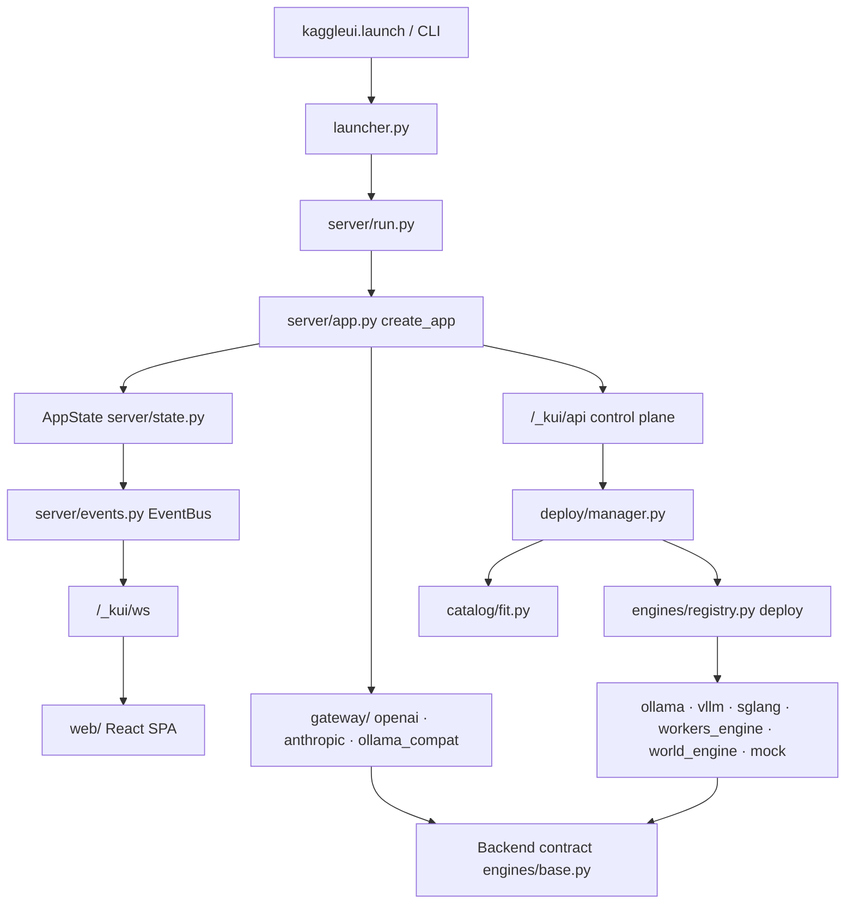

# Repository Guidelines

KaggleUI — a one-cell control panel and multi-protocol inference gateway that hosts AI models (text, image, video, TTS/STT, 3D world) on Kaggle's free GPUs/TPUs. Python backend, React SPA shipped inside the wheel.

## Project Overview

A user pastes one cell into a Kaggle notebook:

```python
!curl -fsSL https://raw.githubusercontent.com/therealfreddied/KaggleUI/main/install.sh | bash
import kaggleui
kaggleui.launch()
```

`launch()` starts the FastAPI server in a background process, prints a link card (Cloudflare/ngrok tunnel URL + admin token, access password, API key), and keeps the cell alive. The panel then lets the user pick a model, deploy it behind an isolated runner, and talk to it through OpenAI, Anthropic, or Ollama-compatible APIs plus the built-in Studio.

Non-negotiables that shape the design: Kaggle sessions are ephemeral, 20 GB of `/kaggle/working` is saved as output, and the preinstalled PyTorch stack must not be broken by `pip install`.

## Architecture & Data Flow



- **Entry chain**: `kaggleui.launch()` (`kaggleui/__init__.py`) → `launcher.py` (spawn, tunnel, `state.json`) → `server/run.py` `build_state()` + `make_server()` → `server/app.py` `create_app(AppState)`.
- **`AppState`** (`server/state.py`) is the process-wide container: `Auth`, `EventBus`, `Probe`, `CatalogService`, `ModelImports`, `TunnelManager`, `DeploymentManager`, `InterfaceManager`, `Updates`. Routes read it; nothing global besides it.
- **Deploy path**: control-plane call → `DeploymentManager` → `catalog/fit.py` (VRAM/quant/GPU verdict) → `engines/registry.deploy(spec, ctx)` dispatches on `spec.model.engine` → engine returns a `Backend` → gateway serves it.
- **Backend contract** (`engines/base.py`): `chat`, `chat_stream`, `completions`, `embeddings`, `images`, `speech`, `voices`, `transcribe`, `job_submit/job_status/job_result`. Anything unsupported raises `Unsupported("…")`, which becomes a clean API error. `OpenAIUpstream` and `WorkerBackend` are the two reusable implementations.
- **Workers** (`engines/workers/*.py`) are standalone FastAPI apps on a localhost port: load the model in a background thread, answer 503 until ready, expose `GET /health` with the load stage, and are built only on fastapi/uvicorn/pydantic so they can run inside isolated `uv` venvs.
- **Engines are subprocesses**: `EngineContext` (`engines/context.py`) supplies `log`, `progress(stage, pct, message)`, `env()` (CUDA pinning, `HF_HOME`), and tracks `ManagedProcess` handles from `proc.py`.
- **Process ownership**: only processes recorded on `EngineContext.processes` (or a `ManagedProcess` alive at shutdown) are stopped. Never `pkill` by name; a deployment's process tree is the only thing it owns.
- **Gateway**: `gateway/openai.py` is the primary surface (`/v1/chat/completions`, embeddings, images, audio…), `anthropic.py` (`/v1/messages`) and `ollama_compat.py` (`/api/*`) translate onto the same internal calls via `gateway/translate.py`. `Backend.native` marks API flavours an upstream speaks natively, so those can be proxied without translation.
- **Realtime**: `EventBus` publishes metrics/logs/state; `/_kui/ws` streams to the SPA, which keeps a react-query cache in sync (`web/src/lib/live.tsx`).
- **Static**: the built SPA (`kaggleui/static`) is served by the same app; reserved prefixes are `/_kui/`, `/v1/`, `/api/`, `/gradio/`, everything else falls back to `index.html`.

## Key Directories

| Path | Purpose |
|---|---|
| `kaggleui/` | Python package; the whole product backend |
| `kaggleui/server/` | FastAPI app, auth/cookies, event bus, Studio WS, static serving, update checks |
| `kaggleui/gateway/` | OpenAI / Anthropic / Ollama-compatible front doors + translation |
| `kaggleui/engines/` | Engine dispatch, backends, install/download logic, `workers/`, `recipes/` YAML |
| `kaggleui/catalog/` | Model discovery (HF, Ollama), `curated.yaml`, `world.yaml`, fit/quant math, imports |
| `kaggleui/deploy/` | `DeploymentManager`: lifecycle, GPU allocation, process supervision |
| `kaggleui/interfaces/` | Optional per-deployment front-ends: Gradio (in-process, proxied under `/gradio/`), Open WebUI and ComfyUI on their own ports |
| `kaggleui/workbench/` | Artifact registry, persisted jobs, multi-model residency/admission, placement, optimization and benchmarks |
| `kaggleui/storage/` | Storage connections (local, rclone, Hugging Face, GitHub), artifact upload/restore |
| `kaggleui/optimize/` | Optimization plans and measurements behind the Optimize page |
| `kaggleui/ml/` | Model Studio: dataset validation, LoRA/QLoRA training, evaluation harness, teacher datasets, merge/GGUF conversion, abliteration wrapper |
| `kaggleui/hosts.py` | Host adapters (Kaggle/Colab/local): capabilities, session info, attached secrets, startup guidance |
| `kaggleui/gguf.py` | GGUF metadata reader used for context lengths, quantization and artifact verification |
| `kaggleui/tunnels/` | Cloudflare quick/named and ngrok exposure, persistence across restarts |
| `kaggleui/system/` | Hardware `Probe` (GPU/TPU/CPU, fake profiles) |
| `web/src/` | React 19 SPA: `pages/`, `components/`, `lib/` (api, types, live, theme) |
| `tests/` | pytest suite, `fixtures/` HTML for parser tests |
| `notebooks/` | The published Kaggle notebook wrapper |

## Development Commands

```bash
# Setup (Python 3.11 used in CI; floor is 3.10)
uv venv --python 3.11 && uv pip install -e ".[dev]"
cd web && pnpm install && pnpm build && cd ..   # builds into kaggleui/static

# Run without a GPU (mock engines + fake hardware: t4x2 | p100 | tpu | cpu)
.venv/bin/python -m kaggleui serve --mock-engines --fake-hw t4x2 --tunnel none
# then open http://127.0.0.1:8890/?token=<printed token>

# Frontend dev server (5173, proxies /_kui /v1 /api /gradio to 8890)
cd web && pnpm dev

# Lint / typecheck / tests
.venv/bin/ruff check kaggleui
cd web && pnpm typecheck
.venv/bin/python -m pytest -q
.venv/bin/python -m pytest tests/test_fit.py -k quant -q     # single area

# End-to-end smoke
.venv/bin/python -m kaggleui selftest --mock-engines --fake-hw t4x2 --out selftest.json

# Package
uv build --wheel    # run after `pnpm build` so the wheel carries the current bundle
```

## Code Conventions & Common Patterns

### Python
- Every module starts with `from __future__ import annotations`; use PEP 604 unions (`str | None`) and builtin generics.
- Ruff config lives in `pyproject.toml`: `E,F,W,I,B,UP`, `line-length = 110`, `E501` ignored, target `py310`. Match the surrounding density — comment the *why*, not the mechanics.
- **No `logging` module.** Notebook output goes through `launcher._display()` (IPython `HTML` when available, plain `print(..., flush=True)` otherwise); server lifecycle lines are `print("[kaggleui] …", flush=True)`. Per-deployment engine output goes through `ctx.log(...)` / `ctx.progress(...)` so it reaches the UI log stream.
- Error layering: `Unsupported` for a capability a backend lacks, `DeployError("message for the user")` for deployment failures, `HTTPException` in routes. Don't leak tracebacks to API responses.
- Models: pydantic in `kaggleui/schemas.py` (`DeploymentSpec`, `Model`, `Preset`, `Settings`, `SettingsPatch`); runtime-only containers are dataclasses (`AppState`, `EngineContext`). Copy settings with `settings.model_copy(deep=True)`.
- Lazy imports are deliberate in `kaggleui/__init__.py` and `engines/registry.py` — importing the package must stay fast and must not pull torch/uv.
- Async by default in server/gateway; blocking work runs in threads or supervised subprocesses (`ManagedProcess`). `util.wait_for()` is the retry/poll helper.
- Paths: always go through `Paths` (`config.py`) / `ctx.paths`; `KAGGLEUI_HOME` defaults to `/tmp/kaggleui`. Big artifacts never belong in `/kaggle/working`.
- IDs from `util.short_id()`; CLI flags are kebab-case and mirror `DEFAULT_PORT`/tunnel defaults from `config.py`.

```python
# Engine progress + subprocess pattern (kaggleui/engines/ollama.py and friends)
ctx.progress("downloading", 0.0, f"Pulling {ref}")
proc = ManagedProcess(argv, ctx.env(), log_path=ctx.log_path("runner"))
ctx.processes.append(proc)
```

### Frontend
- TypeScript strict, function components, no class components. Server state lives in TanStack Query; realtime state in `LiveProvider` (`useLive`, `useOverview`, `useLogs`). Don't add bespoke polling for data `/_kui/ws` already pushes.
- All HTTP goes through `api` in `web/src/lib/api.ts` (`ApiError` carries `status`); fetch error `detail` is surfaced verbatim, and 404/405 means "server older than page".
- `web/src/lib/types.ts` mirrors `schemas.py` by hand — update both sides together.
- Styling is Tailwind v4 (`@tailwindcss/vite`) plus design tokens and custom utilities in `web/src/index.css`; compose with primitives from `components/ui.tsx` (`Button`, `Field`, `Select`, `Drawer`, `Empty`, `VerdictTag`, `ToastProvider`) instead of raw markup. Icons from `lucide-react`.
- Pages are lazy-loaded in `web/src/App.tsx`; a new page needs a route there and a nav entry in `components/Shell.tsx`.
- Studio lives in `pages/Studio.tsx` + `pages/studio/{Chat,Media,World,WorldScene}.tsx`; world rendering uses `@sparkjsdev/spark`/`three`.

## Common Change Recipes

- **Add a curated model**: append to `kaggleui/catalog/curated.yaml` (or `world.yaml`) with `source`, `id`, `name`, `size_gb`, `params_b`, `blurb`; keep it out of the launch path unless the runtime is real.
- **Add an engine for an existing modality**: implement `deploy(spec, ctx) -> (Backend, info)` in `kaggleui/engines/<name>.py`, register the name in `engines/registry.py` (`WORKER_ENGINES` or a branch), add it to `MODALITY_ENGINES` in `catalog/resolve.py`, and give it a `catalog/fit.py` sizing path.
- **Add a worker model type**: subclass the scaffolding in `engines/workers/common.py` (load in a thread, `GET /health` stage, 503 while loading); it must use only fastapi/uvicorn/pydantic.
- **Add a UI page or API call**: route + lazy import in `web/src/App.tsx`, nav entry in `components/Shell.tsx`, method on `api` in `web/src/lib/api.ts`, types in `web/src/lib/types.ts`, route on the server in `server/app.py`.
- **Add an OpenAI/Anthropic/Ollama API feature**: implement on `Backend` in `engines/base.py` (raise `Unsupported` by default), then wire it in `gateway/`; add coverage in `tests/test_translate.py` or `tests/test_server.py`.

## Important Files

| File | Role |
|---|---|
| `kaggleui/__init__.py` | Public API (`launch`, `stop`, `restart_tunnel`) and `__version__` |
| `kaggleui/launcher.py` | Notebook/daemon lifecycle, link card, tunnel handoff |
| `kaggleui/server/app.py` | FastAPI app: control plane, gateway mounting, Studio WS, static SPA |
| `kaggleui/server/state.py` | `AppState` wiring of every subsystem |
| `kaggleui/server/auth.py` | Admin token, access password, API key, cookies (`kui_admin`, `kui_access`) |
| `kaggleui/server/events.py` | `EventBus` → WebSocket broadcast |
| `kaggleui/deploy/manager.py` | Deployment lifecycle and supervision |
| `kaggleui/engines/base.py` | `Backend` contract all runners satisfy |
| `kaggleui/engines/registry.py` | Engine name → deploy function dispatch |
| `kaggleui/engines/context.py` | Per-deployment log/progress/env/GPU context |
| `kaggleui/engines/install.py` | Isolated `uv` venv creation and package installs |
| `kaggleui/catalog/service.py` | Catalog merge/search entry point |
| `kaggleui/catalog/fit.py` | VRAM/quantization/GPU fit verdicts |
| `kaggleui/catalog/curated.yaml` | Hand-picked models, sizes, engine hints |
| `kaggleui/schemas.py` | Typed wire contract shared with `web/src/lib/types.ts` |
| `kaggleui/config.py` | `Paths`, `KAGGLEUI_HOME`, presets, tunnel default |
| `kaggleui/secretstore.py` | Keys/tokens (`secrets.json`, Kaggle Secrets) |
| `kaggleui/proc.py` | `ManagedProcess` subprocess wrapper |
| `kaggleui/selftest.py` | Deploys one model per modality and exercises every API |
| `web/vite.config.ts` | Proxy rules, `__APP_VERSION__` stamp, output to `kaggleui/static` |
| `web/src/App.tsx` | Router, lazy pages, version banner |
| `web/src/lib/live.tsx` | WebSocket + react-query sync |
| `web/src/lib/api.ts` | Single HTTP client |
| `.github/workflows/ci.yml` | The authoritative gate |
| `install.sh` | `curl | bash` installer used by the notebook |

## Runtime/Tooling Preferences

- **Python** ≥ 3.10 (CI uses 3.11). `uv` for venvs and installs; never assume system pip.
- **Package manager**: `pnpm` only — `web/pnpm-lock.yaml` is committed and CI runs `--frozen-lockfile`. **Node 24** in CI. Do not add npm/yarn lockfiles.
- **Lint**: `ruff check kaggleui` (no formatter configured, no prettier/eslint config — keep diffs consistent with neighbors).
- **Tests**: pytest with `asyncio_mode = "auto"`; async test functions need no decorator.
- **Target runtime**: Kaggle Linux with 2×T4, P100, or TPU v5e; local development runs fully on CPU/mock. Some code paths touch Kaggle-only paths (`/kaggle/input`, `/kaggle/working`) and must degrade cleanly elsewhere.

Environment variables (all optional): `KAGGLEUI_HOME` (state/models/logs root), `KAGGLEUI_PORT` (8890), `KAGGLEUI_TUNNEL`, `KAGGLEUI_ADMIN_TOKEN`, `KAGGLEUI_PASSWORD`, `KAGGLEUI_API_KEY`, `KAGGLEUI_OLLAMA_PORT`, `KAGGLEUI_INTERNAL_KEY`, `KAGGLEUI_GRADIO_PASSWORD`, `KAGGLEUI_NOTIFY_URL`, `KAGGLEUI_INPUT_DIR`, `KAGGLEUI_KAGGLE_SECRETS`, `HF_TOKEN`; web dev: `KAGGLEUI_DEV_BACKEND`.

## Testing & QA

`tests/` is an offline-first suite (no weights, no Hub calls). `tests/conftest.py` provides `paths` (a `Paths` root under `tmp_path`) and `hw(profile)` (`Probe(..., fake=...)`), plus an autouse stub of `kaggleui.catalog.hf.bf16_plan` so precision planning never reaches the network — opt back in with your own `AsyncMock`.

| Module | Covers |
|---|---|
| `test_fit.py` | VRAM sizing, quant selection, ranking, safetensors weight parsing |
| `test_filters.py` | Catalog filter validation (param ranges, context minimums, capabilities) |
| `test_parsers.py` | HF/Ollama response parsing, context-length detection |
| `test_engines.py` | Registry dispatch and GPU/TPU refusals before install |
| `test_server.py` | Auth rules and gateway behavior against the real app with mock engines |
| `test_translate.py` | OpenAI ↔ Anthropic translation |
| `test_diffusers_layout.py` | Original-format repos are never launched as diffusers pipelines |
| `test_bf16.py` | fp32 pipelines sized/stored as BF16 |
| `test_world_catalog.py` | World discovery breadth without making arbitrary repos launchable |
| `test_abliterate.py` | Abliteration job validation/queue/worker contract |
| `test_secrets.py` | Secret aliases, hot reload, `0600` local store, endpoints never echo values |
| `test_shutdown.py`, `test_tunnels.py` | Real subprocess shutdown, tunnel readiness before printing a URL |
| `test_tpu.py` | TPU probe and TPU-only runner selection |
| `test_release_versions.py` | Version agreement across package, `pyproject.toml`, `web/package.json`, built bundle |

Expectations:
- Add a test when changing fit/quant math, catalog parsing/filtering, gateway translation, auth, or deployment refusal logic; these are where silent regressions cost money (GPU time) or leak models.
- Prefer behavior-level assertions over internals; the release-version tests are the only intentional cross-file contract tests.
- Run `selftest --mock-engines --fake-hw t4x2` for anything touching deploy/gateway end-to-end; it is part of CI.
- CI order: `pnpm build` → `uv pip install -e ".[dev]"` → `ruff check kaggleui` → `pytest -q` → mock selftest → `uv build --wheel` (artifact uploaded).

## Sharp Edges

- `kaggleui/static/` is generated and gitignored (only `.gitkeep` is tracked). Never hand-edit it; rebuild with `pnpm build`.
- Version bump = edit `kaggleui/__init__.py`, `pyproject.toml`, `web/package.json`, **then** `pnpm build` before packaging. `test_release_versions.py` fails otherwise, and the UI shows a permanent "page is older than the server" banner.
- Never make the app import torch at module import time; notebook start must stay fast and work when GPU libs are missing.
- Keep mock parity: `engines/mock.py` and `--fake-hw` are what CI and local dev rely on, so new deployment features need a mock path.
- `spec.model.engine` is normalized in `schemas.py` (e.g. `transformers_tts` → `transformers_audio`); dispatch and worker sets must agree.
- Weights, venvs, logs and outputs stay under `KAGGLEUI_HOME`; writing them to `/kaggle/working` breaks the 20 GB output limit.
- Heavy stacks (vLLM, SGLang, Chatterbox, world runners) install into their own `uv` envs under `$KAGGLEUI_HOME/envs`; never install into Kaggle's environment.