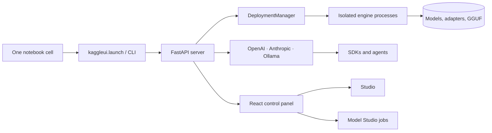

# KaggleUI: complete feature guide

KaggleUI turns one Kaggle notebook cell into a model host and control panel. It runs on the free GPU or TPU the session already has, exposes a browser panel, and serves the deployed models through OpenAI-, Anthropic-, and Ollama-compatible APIs plus a built-in Studio.

This guide describes shipped behavior. Sections 1–10 are the feature tour, section 11 is the generated route and command reference, and section 12 records verification status. Source of truth remains the code under `kaggleui/`, the tests, and the troubleshooting notes in [`README.md`](../README.md).

## Contents

1. [One-cell launch](#1-one-cell-launch)
2. [Model catalog and fit](#2-model-catalog-and-fit)
3. [Engines and deployment](#3-engines-and-deployment)
4. [Interfaces and APIs](#4-interfaces-and-apis)
5. [Studio](#5-studio)
6. [Model Studio workbench](#6-model-studio-workbench)
7. [Storage and backups](#7-storage-and-backups)
8. [Workspace portability and lifecycle](#8-workspace-portability-and-lifecycle)
9. [Hosts and sessions](#9-hosts-and-sessions)
10. [Operations and limits](#10-operations-and-limits)
11. [Route and command reference](#11-route-and-command-reference)
12. [Verification status](#12-verification-status)



## 1. One-cell launch

A single cell bootstraps the package and starts the server:

```python
!curl -fsSL https://raw.githubusercontent.com/therealfreddied/KaggleUI/main/install.sh | bash
import kaggleui
kaggleui.launch()
```

`launch()` resolves or installs the package, starts `kaggleui serve` in a background process, waits for the server to answer, opens the configured tunnel, and prints a link card. The card carries the panel URL, the admin token, the access password, and an API key. Keeping the cell alive keeps the process alive; the server never extends or defeats Kaggle's idle timeout.

What the launcher guarantees:

- The server is reachable before a URL is printed. Tunnel readiness is checked, not assumed.
- The tunnel choice defaults to Cloudflare on Kaggle and Colab and to no tunnel elsewhere. `--tunnel cloudflare`, `cloudflare_named`, `ngrok`, or `none` overrides it; a named tunnel uses the configured token and hostname.
- A stopped launcher can be restarted without losing the tunnel, and a retained tunnel is adopted rather than duplicated.
- State lives in `KAGGLEUI_HOME` (default `/tmp/kaggleui`), not in the notebook working directory. Kaggle saves 20 GB of `/kaggle/working` as output; model weights, virtual environments, logs, and conversion scratch space deliberately stay outside it.
- The same one-cell flow works on Colab, with host detection replacing Kaggle-specific secrets and datasets with Colab equivalents.

The panel is protected by an admin token and an optional access password. Clients use the API key for `/v1`, `/api`, and media endpoints. Tokens and passwords can be regenerated from Settings; local secrets are stored with `0600` permissions and are never echoed back by the API.

`kaggleui stop` stops the background server. `kaggleui launch --no-block` starts it without holding the cell. `kaggleui selftest` deploys one model per modality and exercises the APIs; it is the end-to-end smoke test used by CI.

## 2. Model catalog and fit

The Models tab merges four sources:

- **Curated entries** from `catalog/curated.yaml` and `catalog/world.yaml`: hand-picked text, image, video, audio, speech, and world models with sizes, parameter counts, blurbs, and engine hints.
- **Live Hugging Face search**, including repository metadata, safetensors weight sizes, and architecture information.
- **Ollama tags** for locally installed and pullable models.
- **Attached models** found under the Kaggle input directory or an explicit local path, including GGUF files.

Curated results stay usable offline. Live sources are best effort; a failed Hub or Ollama lookup removes that source, not the page.

### Default view

The browser opens on **Fits this machine** (`fit=fits`), not on the full catalog. The toggle switches to **All models**. The choice is remembered per browser: choosing All and reloading keeps All, while **Reset filters** returns to the machine-aware default. World, attached-model, mesh, and audio-specific entry points intentionally open on All because their fit classification needs the attachment or is not a text/VRAM decision.

If no model matches the active filters, a **Nothing fits this machine** empty state explains the situation and offers **Show all models** instead of leaving a blank list. Filters cover modality, source, size, context window, and capability; sorting covers lowest and highest parameter count; **Load more** pages deeper into live results.

### Fit is a verdict, not a guess

`catalog/fit.py` compares each candidate against detected hardware and returns a verdict plus the quantization it would need:

| Verdict | Meaning |
|---|---|
| Fits | The model fits comfortably at the selected or best precision. |
| Tight | It fits only at lower precision or by using most of the available VRAM. |
| Needs quantization | A smaller quant makes it fit. |
| Does not fit | No supported quant fits the detected device. |
| Unknown | Metadata is insufficient, or the model is not a text/VRAM-shaped workload. |

The panel shows the verdict, the preferred quant, and the GPU count the deployment would need. Deployment re-checks fit and refuses impossible combinations before installing anything. A refused deployment costs no download and no GPU time.

### Context limits

Context is assembled from the most authoritative source available, without ever lowering a known value:

1. Architecture metadata (`config.json`, pipeline metadata) for Hugging Face and diffusers models.
2. GGUF metadata for attached or converted files (`*.context_length`, taking the largest declared window).
3. Ollama tag metadata for Ollama models.
4. [models.dev](https://models.dev) for open-weight models with an exact name match.

Imported model records preserve `context_length`, so a window discovered in one session is not dropped when the catalog is reconstructed. Ollama entries merge the tag window with curated knowledge using the maximum, so a curated entry can raise but never silently lower a published window.

The detail drawer shows `N context` and, when it differs, `N max output`. The context picker offers the standard ladder up to the model's published maximum, adds the maximum itself, and keeps an already-selected custom value. A model with no published window gets the full ladder up to 1,048,576 tokens plus an explicit hint that the limit is unpublished, so the user can still pick a sane window for the KV cache. Llama.cpp placement, KV-cache cost, and the chosen context are deployment options, not hard-coded limits.

### models.dev as a secondary statistics source

`catalog/models_dev.py` fetches the public models.dev catalog and indexes only entries that declare open weights. Names are normalized by lowercasing and stripping punctuation, so `Qwen/Qwen3-8B` and `qwen3:8b` share a key. Short aliases are published only when they resolve to exactly one model; an ambiguous name is dropped rather than borrowing another provider's limits.

Lookup order is exact URL → repository basename → repository id → display name → Ollama ref → ref basename. The join fills only empty context and output limits and then records a `models_dev` facts block: family, knowledge cutoff, release date, last update, attachment support, reasoning, tool calling, open weights, and input/output modalities. Existing metadata always wins.

The fetch runs with short deadlines (1.5 s during search, 5 s during detail), is cached for six hours, is bounded in size, and returns an empty index on network or parse failure. A catalog search therefore behaves normally offline; models.dev is an enrichment, not a dependency. The detail drawer labels these facts **Facts from models.dev** and never presents them as local measurements.

## 3. Engines and deployment

A deployment is a `DeploymentSpec`:

| Field | Values |
|---|---|
| `modality` | `text`, `image`, `video`, `tts`, `audio`, `stt`, `world`, `mesh` |
| `model` | `source`, `id`, optional `variant`, and `engine` |
| `interface` | `studio`, `gradio`, `openwebui`, `comfyui`, `none` |
| `options` | Engine options such as context size, offload mode, or dtype |
| `gpus` | Explicit GPU indices; otherwise chosen from free VRAM |
| `lifecycle` | `direct` (one process) or `llama_swap` (shared llama-swap process) |
| `residency` | `manual`, `pinned`, or `on_demand` with an idle timeout |
| `placement` | Explicit CPU/GPU layer placement for llama.cpp |

Engine dispatch is explicit:

| Engine | Runs | Notes |
|---|---|---|
| `ollama` | Text, embeddings, some vision | Uses the Ollama server and local model store. |
| `llamacpp` | GGUF text models | Native runner, optional llama-swap lifecycle, explicit placement. |
| `vllm` | High-throughput text serving | Separate virtual environment; GPU required. |
| `sglang` | High-throughput text serving | Separate virtual environment; GPU required. |
| `transformers` | Text fallback | Worker process; broad architecture coverage. |
| `diffusers` | Image generation | Worker process. |
| `diffusers_video` | Video generation | Worker process and job API. |
| `diffusers_world` / `world_recipe` | World generation | Recipe-driven world runners. |
| `kokoro`, `chatterbox`, `transformers_tts`, `transformers_audio` | TTS and audio | Worker processes with the audio API. |
| `faster_whisper`, `transformers_asr` | Speech-to-text | Worker processes. |
| `mock` | Every modality | Deterministic CI and local-development backend. |

Heavy stacks install into their own `uv` environments under `$KAGGLEUI_HOME/envs`. Kaggle's preinstalled PyTorch stack is never modified. Unsupported operations raise `Unsupported`, which the API turns into a clean `501`-class error instead of a traceback.

Workers are standalone FastAPI applications on localhost ports. They load weights in a background thread, answer `503` until ready, and expose `GET /health` with a load stage and percentage. The panel subscribes to those stages through the event bus, so download, install, load, and serving are visible as they happen.

GPU admission and placement:

- A GPU cannot be double-booked; the manager checks free memory and existing assignments.
- Pinned deployments are never evicted. On-demand deployments cold-start per request and stop after `idle_timeout_s` (minimum 30 seconds).
- TPU-only hardware routes supported models to TPU runners and refuses engines that require CUDA.
- `llama_swap` is accepted only with the llama.cpp engine; unsupported combinations fail validation before launch.
- Model artifacts resolve to their first shard, skipping `mmproj` projector files.

Every deployment is supervised. Stopping removes only processes KaggleUI started, including nested children and retained tunnel processes. Restart, logs, and state survive a page reload.

## 4. Interfaces and APIs

A deployment can serve more than one front door:

| Interface | Path | Use |
|---|---|---|
| Studio | `/_kui` and the SPA | Built-in chat, media, and world playgrounds. |
| Gradio | `/gradio/{dep_id}` | In-process or proxied Gradio app owned by the deployment. |
| Open WebUI | Its own port | Chat UI attached to an OpenAI-compatible deployment. |
| ComfyUI | Its own port | Image workflow UI for diffusers deployments. |
| None | API only | Headless serving. |

The primary API is OpenAI-compatible under `/v1`: chat completions (streaming and non-streaming), legacy completions, embeddings, image generation, speech, transcriptions, translations, audio generations, voices, model listing and detail, health, video jobs and content, world generation and assets, and start frames. Anthropic clients use `/v1/messages` and `/v1/messages/count_tokens`; Ollama clients use `/api/chat`, `/api/generate`, `/api/embed`, `/api/embeddings`, `/api/pull`, `/api/show`, `/api/tags`, `/api/ps`, and `/api/version`.

`Backend.native` marks API flavors an upstream speaks directly. Those requests can be proxied without translation; everything else goes through `gateway/translate.py`, which preserves tool calls, images, streaming deltas, usage, and finish reasons. A backend that lacks a capability raises `Unsupported`, and the front door returns a clear error rather than a malformed response.

Reasoning is negotiated per runtime. OpenAI accepts `reasoning_effort`, Anthropic accepts `thinking` plus `output_config.effort`, and Ollama accepts `think`. Only levels declared by the model or runner are offered; an unsupported explicit level errors instead of being silently downgraded. Reasoning streams separately where the runner exposes it.

Long-running media uses the job API:

- `POST /jobs` submits image, video, world, or other asynchronous work.
- `GET /jobs/{id}` returns state, progress, and result metadata.
- `GET /jobs/{id}/assets` lists produced files.
- `POST /jobs/{id}/cancel` is idempotent.
- Video and world endpoints also expose content and asset routes for clients that address results directly.

The API key is separate from the admin token. Admin routes manage deployments, settings, secrets, catalog imports, workbench jobs, storage, backups, and updates. Gateway routes serve models and use the API key. Cookies (`kui_admin`, `kui_access`) cover the panel, and login/logout routes rotate access state.

## 5. Studio

Studio is the built-in client for every modality:

- **Chat** streams answers, shows reasoning when the runner separates it, supports file and image attachments, exposes the active model's reasoning levels, and keeps conversations local to the browser.
- **Media** drives image, video, TTS, and transcription deployments with the same model picker and job progress used by the API.
- **World** generates and explores world scenes, including asset browsing and live progress for long jobs.
- **Models** lists ready deployments and resolves the served name, deployment id, or underlying model id for each request.

The Studio WebSocket (`/_kui/studio/ws`) streams tokens and media progress. The panel's general WebSocket (`/_kui/ws`) pushes metrics, logs, and deployment state into the React Query cache; pages do not poll for data that socket already provides.

File inputs are passed through to backends that support them. If a model rejects attachments, the UI shows the backend error rather than silently dropping the file. Reasoning, tool calls, and usage appear only when the backend reports them; nothing is synthesized.

## 6. Model Studio workbench

Model Studio is the local training and conversion pipeline. Every step is a persisted job with logs, progress, cancellation, and restart-safe state.

1. **Dataset.** Upload JSONL, JSON, or CSV as an artifact. Validation reports the detected format, sample count, token estimate, and warnings. Every row must be a `messages` list or a list of conversational turns; unsupported formats are rejected with the accepted list.
2. **Train.** Choose a safetensors base model (not GGUF), a dataset artifact, and LoRA or QLoRA. The recipe records rank, learning rate, epochs, and target modules. A run with checkpoints can be resumed from the newest checkpoint.
3. **Evaluate.** Run a deterministic harness profile against a ready deployment. Graders are `exact`, `contains_any`, `regex`, `json_valid`, and `tool_call_name`; each case records pass/fail and detail, and the report is saved as an artifact.
4. **Convert.** Merge an adapter into the base recorded in its provenance, then export GGUF `Q4_K_M`, `Q5_K_M`, `Q8_0`, or `F16`. Lower-level merge and quantize endpoints remain available. The GGUF is metadata-checked before registration.
5. **Deploy.** Deploy the resulting artifact with `source: "artifact"`; engine resolution picks the first shard.

Additional jobs:

- **Teacher datasets** are generated only by deployments the user runs. KaggleUI never calls a paid teacher API.
- **Abliteration / edit** reuses the import pipeline and registers the result as a model artifact.
- **Benchmark** measures TTFT and tokens/s across context sizes and prompt lengths with `kaggleui bench`.
- **Artifacts** can be verified, exported, and deleted; provenance records the parent model, dataset, recipe, and job.

Job states are `queued`, `running`, `succeeded`, `failed`, `cancelled`, and `interrupted`. Children emit progress as `KUI_EVENT` lines, which the runner parses into durable events. The workbench uses SQLite under `KAGGLEUI_HOME`, so a server restart does not lose queued work.

Training needs a real GPU and a compatible stack. Mock engines exercise the wiring, not model quality. The panel refuses to start a training job when the selected base, dataset, or hardware cannot satisfy the recipe, instead of failing after a long download.

## 7. Storage and backups

Storage connections describe where artifacts and model files can be copied:

| Kind | Config | Use |
|---|---|---|
| `local` | Path | A mounted disk or network volume. |
| `rclone` | Remote and path | Any rclone-supported backend. |
| `hf` | Repository and token secret | Hugging Face repositories. |
| `github` | Repository, branch, path, stored token | Snapshots and workspace documents; KaggleUI can create the private repository. GitHub is not used for binaries. |

A connection can be read-only, and secrets are referenced by name rather than stored in the connection record. The storage API lists connections, checks reachability, and copies artifacts with progress.

Backups are content-addressed:

- A backup selects artifacts, deployments, or both, records sizes and SHA-256 checksums, and writes a manifest plus files to the destination.
- Restore verifies the manifest and checksums before replacing local content. A mismatched or partial backup is refused.
- Historical versions remain listed per artifact. `models backup`, `models remote`, and `models restore` expose the same operations from the CLI with `--confirm` for destructive steps.
- The panel supports automatic backups of changed artifacts with debounce, so repeated edits do not upload on every write.
- Binary model files never go to GitHub; GitHub connections are for workspace documents and small snapshots.

Storage paths stay under the configured root. Restores that would escape it are rejected.

## 8. Workspace portability and lifecycle

A workspace is the portable description of a KaggleUI instance: profiles, settings, connection references, deployment sets, saved prompts, and UI state. Secrets are references, not values, and are never exported.

Operations:

- **Export** produces a versioned document with a preview of what will be included.
- **Import** validates the document, reports conflicts, and applies only with confirmation. Missing secret references are reported rather than invented.
- **Backup and restore** copy workspace documents to a storage connection and restore them with checksums.
- **History and rollback** keep prior workspace snapshots; rollback requires confirmation.
- **Sync** compares the local workspace with a GitHub or storage destination, shows added, changed, and deleted entries, and writes a snapshot only after review.
- **GitHub setup takes one paste.** The Workspace page asks for a classic token (with a button that opens GitHub's token form pre-filled with the `repo` scope), then either creates a private repository with an initial commit or links an existing one. The workspace directory and document are created by the first backup; nothing has to be made by hand on github.com.
- **Deployment sets** group deployment specs so a machine can be reproduced with one activation.
- **Model backups** preserve artifact bytes separately from workspace metadata.

`kui workspace` and `kui models` expose these operations locally. The management API exposes the same state for remote clients. The CLI writes profiles locally and uses a management token to reach an instance; it does not store a Kaggle account or password.

## 9. Hosts and sessions

KaggleUI adapts to the host it runs on but never pretends to be a scheduler.

| Host | Detection and behavior |
|---|---|
| Kaggle | Detects `/kaggle/input` and `/kaggle/working`, reads Kaggle Secrets (`HF_TOKEN`, `NGROK_AUTHTOKEN`, and friends), and defaults to a Cloudflare tunnel. `/kaggle/working` is the saved output; model storage stays in `KAGGLEUI_HOME`. |
| Colab | Detects Colab, reads `google.colab.userdata` for secrets, has no `/kaggle/working` output, and defaults to a Cloudflare tunnel. |
| Local Linux | Runs on CPU, CUDA, or mock hardware. Defaults to no tunnel and a localhost URL. |
| TPU | Detects TPU v5e and selects TPU-compatible runners; CUDA-only engines are refused. |

Sessions are interactive and finite. KaggleUI does not keep a notebook alive, evade idle timeouts, or claim that a stopped session still serves models. When a session ends, tunnel processes, workers, and temporary environments end with it; anything worth keeping belongs in a storage connection or workspace backup.

The fake hardware profiles (`t4x2`, `p100`, `tpu`, `cpu`) make the fit, placement, and refusal logic testable without a GPU. Mock engines make the full deploy → serve → API path testable without weights.

## 10. Operations and limits

- **No orphan killing.** KaggleUI stops only processes it started and tracks ownership per deployment, including child processes and retained tunnels. It never runs a blanket `pkill`.
- **No hidden billing.** There are no paid teacher APIs and no external inference calls unless the user configures them. Weights come from the sources the user selected.
- **No binaries in GitHub.** Repository contents and releases are code and metadata; model artifacts go to model storage.
- **Updates are explicit.** The panel checks for a newer release and shows the version; installing an update is a user action with visible logs. The page warns when it is older than the server so stale clients are not trusted silently.
- **Disk is finite.** Virtual environments, weights, conversion scratch space, and logs all consume `KAGGLEUI_HOME`. The overview reports disk and memory pressure, and large conversions can be refused before they exhaust the volume.
- **Memory is admitted.** Fit checks and GPU allocation happen before install. A model that cannot fit is not downloaded to fail later.
- **Errors are for users.** `DeployError` messages explain the refused action; API responses do not leak tracebacks. Unsupported capabilities are named.
- **Secrets stay secret.** Local secrets use `0600`, API responses never echo values, and exports contain references only.
- **Offline degradation.** Catalog search, models.dev enrichment, and update checks tolerate network failure. Curated models and already-downloaded models remain usable.

## 11. Route and command reference

Routes were generated from the decorators in `kaggleui/server/*.py` and `kaggleui/gateway/*.py`. Reserved prefixes are `/_kui/`, `/v1/`, `/api/`, and `/gradio/`; every other path falls back to the SPA `index.html`.

WebSocket routes are not decorators in the generated table:

| Protocol | Path | Purpose |
|---|---|---|
| WebSocket | `/_kui/ws` | Metrics, logs, deployment and job state. |
| WebSocket | `/_kui/studio/ws` | Studio tokens and media progress. |
| WebSocket | `/gradio/{dep_id}/{path:path}` | Gradio proxy transport. |

### Control plane (`/_kui/api`)

| Method | Path |
|---|---|
| `POST` | `/_kui/api/access-login` |
| `POST` | `/_kui/api/catalog/abliterate` |
| `POST` | `/_kui/api/catalog/assess` |
| `GET` | `/_kui/api/catalog/detail` |
| `GET` | `/_kui/api/catalog/imports` |
| `POST` | `/_kui/api/catalog/imports` |
| `DELETE` | `/_kui/api/catalog/imports/{ident}` |
| `GET` | `/_kui/api/catalog/imports/{ident}/models/{index}` |
| `GET` | `/_kui/api/catalog/meta` |
| `GET` | `/_kui/api/catalog/original` |
| `GET` | `/_kui/api/catalog/search` |
| `POST` | `/_kui/api/credentials/regenerate` |
| `GET` | `/_kui/api/deployments` |
| `POST` | `/_kui/api/deployments` |
| `DELETE` | `/_kui/api/deployments/{dep_id}` |
| `GET` | `/_kui/api/deployments/{dep_id}/logs` |
| `POST` | `/_kui/api/deployments/{dep_id}/restart` |
| `POST` | `/_kui/api/login` |
| `POST` | `/_kui/api/logout` |
| `GET` | `/_kui/api/overview` |
| `GET` | `/_kui/api/preset` |
| `GET` | `/_kui/api/secrets` |
| `POST` | `/_kui/api/secrets/import` |
| `POST` | `/_kui/api/secrets/reload` |
| `DELETE` | `/_kui/api/secrets/{name}` |
| `PUT` | `/_kui/api/secrets/{name}` |
| `GET` | `/_kui/api/session` |
| `PUT` | `/_kui/api/settings` |
| `GET` | `/_kui/api/studio/models` |
| `GET` | `/_kui/api/studio/worlds/{ident}/assets/{path:path}` |
| `GET` | `/_kui/api/studio/worlds/{ident}/content` |
| `GET` | `/_kui/api/system` |
| `GET` | `/_kui/api/tunnels` |
| `POST` | `/_kui/api/tunnels/main/restart` |
| `GET` | `/_kui/api/updates` |
| `POST` | `/_kui/api/updates/install` |
| `GET` | `/_kui/api/updates/logs` |

### Gradio proxy

| Method | Path |
|---|---|
| `GET` | `/gradio/{dep_id}` |

### Lifecycle and authentication

| Method | Path |
|---|---|
| `GET` | `/_kui/login` |
| `POST` | `/_kui/login` |
| `GET` | `/instance` |
| `GET` | `/jobs` |
| `GET` | `/jobs/{job_id}` |
| `POST` | `/jobs/{job_id}/cancel` |
| `GET` | `/jobs/{job_id}/logs` |
| `POST` | `/jobs/{job_id}/resume` |
| `POST` | `/shutdown` |
| `GET` | `/workspace` |
| `POST` | `/workspace/backup` |
| `PUT` | `/workspace/config` |
| `GET` | `/workspace/export` |
| `GET` | `/workspace/history` |
| `POST` | `/workspace/import` |
| `GET` | `/workspace/preview` |
| `POST` | `/workspace/restore` |
| `POST` | `/workspace/rollback` |
| `GET` | `/workspace/status` |

### Management (`/management`)

| Method | Path |
|---|---|
| `GET` | `/management` |
| `POST` | `/management` |
| `DELETE` | `/management/{token_id}` |

### Ollama-compatible (`/api`)

| Method | Path |
|---|---|
| `POST` | `/api/chat` |
| `POST` | `/api/embed` |
| `POST` | `/api/embeddings` |
| `POST` | `/api/generate` |
| `GET` | `/api/ps` |
| `POST` | `/api/pull` |
| `POST` | `/api/show` |
| `GET` | `/api/tags` |
| `GET` | `/api/version` |

### OpenAI, Anthropic, media and world (`/v1`)

| Method | Path |
|---|---|
| `POST` | `/v1/audio/generations` |
| `POST` | `/v1/audio/speech` |
| `POST` | `/v1/audio/transcriptions` |
| `POST` | `/v1/audio/translations` |
| `GET` | `/v1/audio/voices` |
| `POST` | `/v1/chat/completions` |
| `POST` | `/v1/completions` |
| `POST` | `/v1/embeddings` |
| `GET` | `/v1/health` |
| `POST` | `/v1/images/generations` |
| `POST` | `/v1/messages` |
| `POST` | `/v1/messages/count_tokens` |
| `GET` | `/v1/models` |
| `GET` | `/v1/models/{model_id:path}` |
| `POST` | `/v1/start-frames` |
| `GET` | `/v1/videos` |
| `POST` | `/v1/videos` |
| `GET` | `/v1/videos/{video_id}` |
| `GET` | `/v1/videos/{video_id}/content` |
| `GET` | `/v1/voices` |
| `GET` | `/v1/worlds` |
| `POST` | `/v1/worlds` |
| `GET` | `/v1/worlds/{ident}` |
| `GET` | `/v1/worlds/{ident}/assets` |
| `GET` | `/v1/worlds/{ident}/assets/{path:path}` |
| `GET` | `/v1/worlds/{ident}/content` |

### Workbench control plane (`/workbench`)

| Method | Path |
|---|---|
| `GET` | `/workbench` |
| `GET` | `/workbench/artifacts` |
| `GET` | `/workbench/artifacts/{artifact_id}` |
| `POST` | `/workbench/artifacts/{artifact_id}/delete` |
| `POST` | `/workbench/artifacts/{artifact_id}/export` |
| `POST` | `/workbench/artifacts/{artifact_id}/verify` |
| `GET` | `/workbench/deployment-sets` |
| `POST` | `/workbench/deployment-sets` |
| `DELETE` | `/workbench/deployment-sets/{set_id}` |
| `POST` | `/workbench/deployment-sets/{set_id}/activate` |
| `GET` | `/workbench/deployments` |
| `POST` | `/workbench/deployments/{dep_id}/start` |
| `POST` | `/workbench/deployments/{dep_id}/stop` |
| `GET` | `/workbench/jobs` |
| `GET` | `/workbench/jobs/{job_id}` |
| `GET` | `/workbench/jobs/{job_id}/log` |
| `GET` | `/workbench/ml/convert` |
| `POST` | `/workbench/ml/convert` |
| `GET` | `/workbench/ml/datasets` |
| `POST` | `/workbench/ml/datasets` |
| `POST` | `/workbench/ml/datasets/validate` |
| `GET` | `/workbench/ml/edit` |
| `POST` | `/workbench/ml/edit` |
| `GET` | `/workbench/ml/harness` |
| `POST` | `/workbench/ml/harness` |
| `GET` | `/workbench/ml/harness/{artifact_id}` |
| `POST` | `/workbench/ml/merge` |
| `POST` | `/workbench/ml/quantize` |
| `GET` | `/workbench/ml/teacher` |
| `POST` | `/workbench/ml/teacher` |
| `POST` | `/workbench/ml/teacher/{job_id}/cancel` |
| `GET` | `/workbench/ml/train` |
| `POST` | `/workbench/ml/train` |
| `POST` | `/workbench/ml/train/{job_id}/cancel` |
| `POST` | `/workbench/ml/train/{job_id}/resume` |
| `GET` | `/workbench/model-backups` |
| `POST` | `/workbench/model-backups` |
| `GET` | `/workbench/model-backups/remote` |
| `POST` | `/workbench/model-backups/restore` |
| `GET` | `/workbench/optimize` |
| `PUT` | `/workbench/optimize` |
| `POST` | `/workbench/placement/preview` |
| `POST` | `/workbench/restore` |
| `GET` | `/workbench/storage` |
| `POST` | `/workbench/storage` |
| `GET` | `/workbench/storage/cli` |
| `DELETE` | `/workbench/storage/{name}` |
| `POST` | `/workbench/storage/{name}/config` |
| `POST` | `/workbench/storage/{name}/test` |

### Commands

`kaggleui` is the server entry point. Common flags for `serve`, `launch`, `selftest`, and `bench` are `--port` (default 8890), `--tunnel {cloudflare,cloudflare_named,ngrok,none}`, `--preset`, `--mock-engines`, `--fake-hw {t4x2,p100,tpu,cpu}`, and `--home`. `serve` also takes `--host` (default `127.0.0.1`).

| Command | Purpose |
|---|---|
| `kaggleui serve` | Run the server in the foreground. |
| `kaggleui launch [--no-block]` | Start in the background, print the link card, and optionally keep the cell alive. |
| `kaggleui selftest [--modalities …] [--out selftest.json]` | Deploy the smallest model per modality and exercise every API. |
| `kaggleui bench --model … [--ctx …] [--prompt-tokens …] [--runs N]` | Measure TTFT and tokens/s and save a report. |
| `kaggleui stop` | Stop a background server for the selected home. |
| `kaggleui kui …` | Delegate to the local lifecycle client. |

`kui` is the profile-aware remote client. Global flags are `--profile`, `--url`, `--token`, `--json`, and `--config`. Exit codes distinguish usage (2), profile/config problems (3), unreachable server (4), rejected key (5), remote error (6), conflict (7), and Kaggle CLI failure (8).

| Command | Purpose |
|---|---|
| `kui profile list \| show \| use \| add` | Manage local profiles and references. |
| `kui instance list \| add \| show` | Manage instance URLs and tokens. |
| `kui workspace-set` / `kui notebook-set` | Save workspace and notebook profiles. |
| `kui status` | Show the active instance summary. |
| `kui deployments list \| start \| stop` | Inspect and control deployments. |
| `kui jobs list \| show \| log` | Inspect workbench jobs and logs. |
| `kui storage list` | List storage connections. |
| `kui workspace status \| preview \| export \| import \| backup \| restore \| history \| rollback` | Portability, sync, and rollback operations. |
| `kui models status \| remote \| backup \| restore` | Model artifact backup and restore. |
| `kui notebook deploy \| status \| open \| stop \| output` | Drive Kaggle notebook sessions. |
| `kui shutdown --confirm [--keep-models]` | Stop the server without ending the notebook session. |
| `kui tui` | Terminal interface over the same client. |

## 12. Verification status

The guide is checked against the code and the test suite. At the time of writing:

```bash
python3 -m pytest -q
ruff check kaggleui tests
cd web && pnpm --package=typescript@5.9.3 dlx tsc -p . --noEmit
cd web && pnpm exec vite build
```

The observed run was `7 failed, 295 passed, 1 skipped in 516.90s`. The full suite has seven known environmental failures on this Termux host, all in process- and tunnel-shutdown tests that need a real Linux process tree and tunnel binaries:

- `tests/test_shutdown.py::test_notebook_stop_with_open_websocket_and_relaunch`
- `tests/test_shutdown.py::test_forced_stop_cleans_detached_children`
- `tests/test_shutdown.py::test_stale_state_does_not_stop_unrelated_process`
- `tests/test_shutdown.py::test_retained_tunnel_is_adopted_and_full_stop_closes_it`
- `tests/test_shutdown.py::test_update_stop_retains_tunnel_child_then_full_stop_removes_it`
- `tests/test_shutdown.py::test_stale_tunnel_record_does_not_stop_unrelated_process`
- `tests/test_tunnels.py::test_failed_tunnel_does_not_publish_localhost`

Everything else passes, including the catalog, GGUF, models.dev, fit, filter, parser, engine, gateway, translation, auth, secrets, release-version, workbench, and workspace tests. The Vite build and TypeScript check pass on the pinned TypeScript 5.9.3 toolchain.

The feature-specific evidence for this guide:

- Default fit, reset behavior, and the empty state are exercised in the Models browser; the browser proof records the active segment and the `fit=fits` request.
- GGUF context metadata is covered by `tests/test_gguf.py`, attached-scan parsing by `tests/test_parsers.py`, and imported-window preservation by `tests/test_models_dev.py`.
- models.dev indexing, ambiguity handling, lookup order, gap-only enrichment, and offline fallback are covered by `tests/test_models_dev.py`.
- The context ladder and detail facts are type-checked and verified in the live UI against a mock server.
- Route counts and command names above are generated from the decorators and argparse definitions; they are not hand-maintained lists.